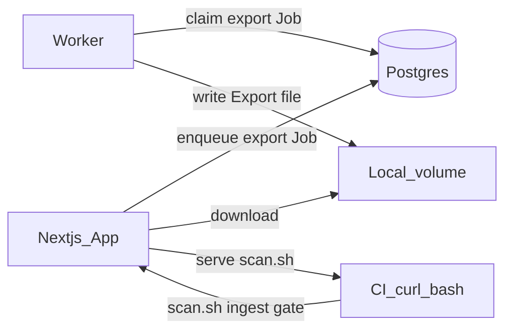
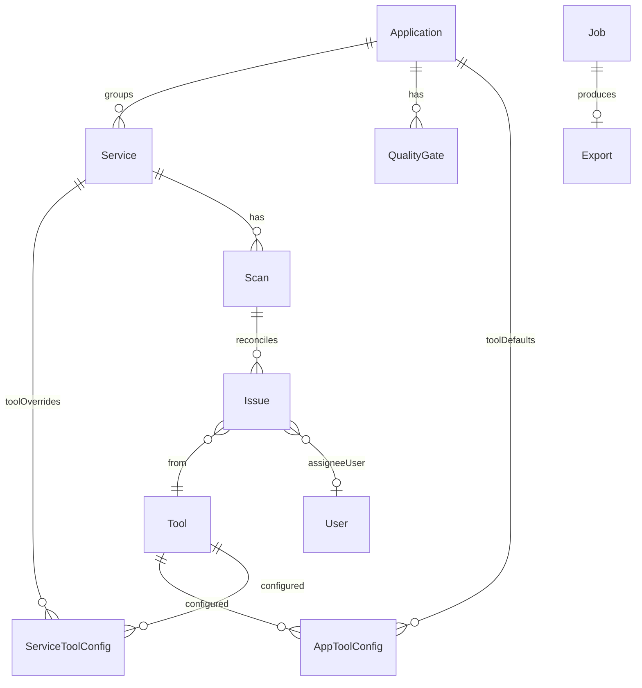
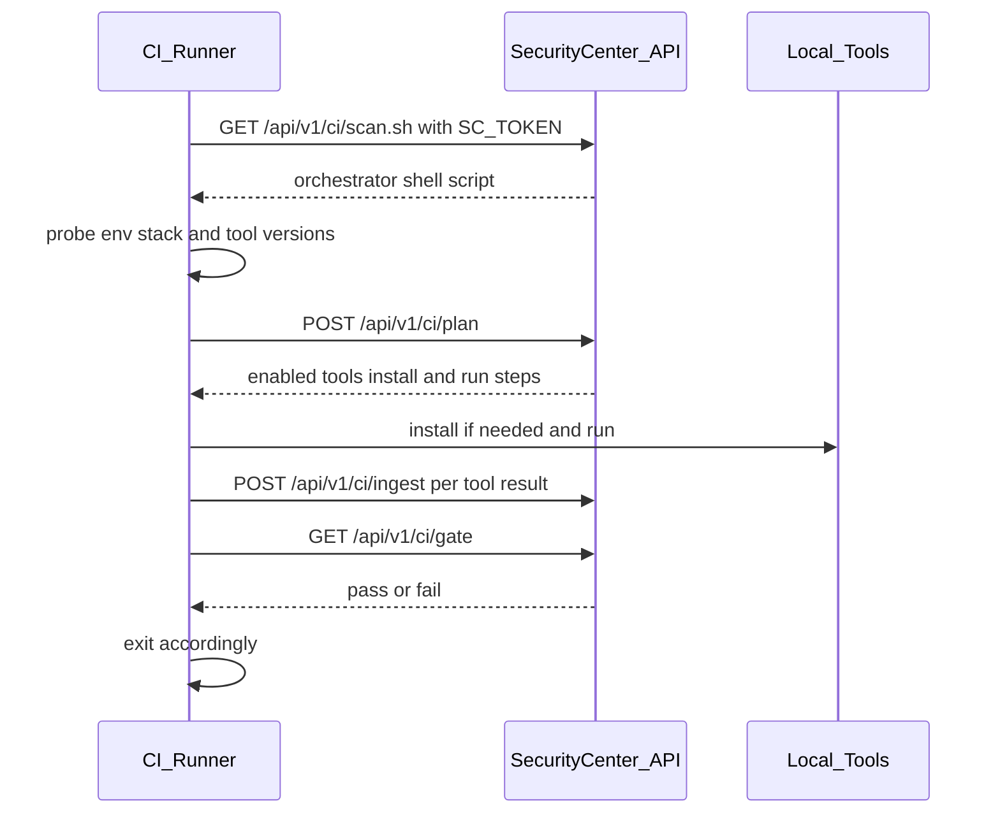
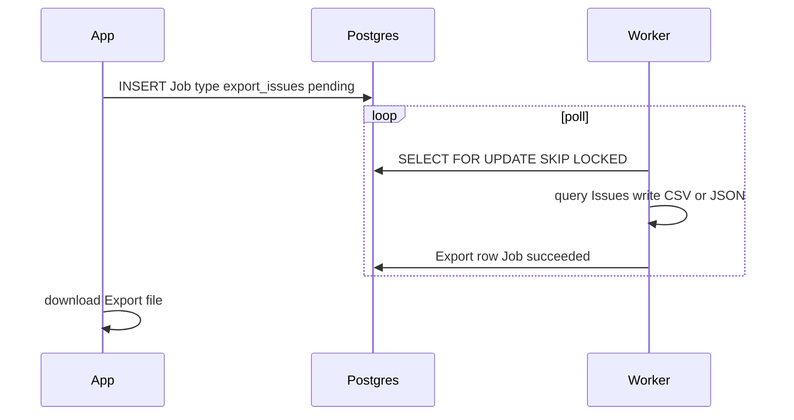

# Security Center — Architecture & How It Works

This document describes the **V1** product as built: an **ASPM-lite** security catalog and quality gate. It is not a SonarQube replacement. Scanners are **inputs**; Security Center owns the catalog, Issues, ownership, scores, and the CI gate.

For a short quickstart, see [README.md](README.md). Deferred work lives in [TODO.md](TODO.md).

---

## 1. Positioning

| Security Center owns | Scanners / external tools own |
|----------------------|-------------------------------|
| Software catalog (applications → services) | Finding detection (secrets, SCA, SAST, …) |
| Normalized **Issues** + assignment | Tool-specific output formats |
| Dedup / reconciliation across scans | Running binaries on the CI runner |
| Quality score + quality gate | — |
| Export of issue reports | — |

**Product name:** Security Center.

---

## 2. High-level architecture

Three processes; no Redis, no host agent, no server-side clone/scan in V1.



| Process | Runs where | Responsibility |
|---------|------------|----------------|
| **App** | Security Center host | UI, API, plan/normalize/score, serve `scan.sh`, enqueue exports |
| **Worker** | Same Compose stack (`src/worker`) | `export_issues` jobs only (CSV/JSON) |
| **CI** | Customer pipeline | One `curl \| bash`; tools run **on the runner**, then results are uploaded |

**Ingest-first:** analysis always executes on the CI runner. The Security Center host does not clone repos or run scanners in V1.

---

## 3. Domain model



### Core entities

| Entity | Role |
|--------|------|
| **Application** | Product / system grouping one or more services |
| **Service** | Deployable unit with a CI token and optional repo URL |
| **Tool** | Seeded scanner adapter (gitleaks, npm-audit, …) |
| **AppToolConfig** | Per-application default: tool enabled/disabled for pipeline |
| **ServiceToolConfig** | Per-service override of app defaults |
| **Scan** | One CI scan run for a service |
| **Issue** | Normalized finding (what the UI calls an issue) |
| **QualityGate** | Score threshold + “fail on new High/Critical” |
| **Job / Export** | Background export of issues to a downloadable file |
| **User** | OIDC user; Issues assign to a **user** only in V1 |

### Issue vs repo ticket

| Term | Meaning |
|------|---------|
| **Issue** | Finding stored in Security Center |
| **Repo ticket** | GitHub/GitLab/etc. issue opened *from* an Issue — **V2** |

---

## 4. Per-app / per-service tool configuration

1. V1 tools are seeded in the DB.
2. **Application** sets default enable/disable per tool (“run in pipeline”).
3. **Service** may override those defaults.
4. **Effective config** = app defaults ⊕ service overrides.
5. `scan.sh` asks the API for the effective set for that service token and only installs/runs those tools (plus adapter `detect`, so e.g. pip-audit skips if there is no Python project even when enabled).

There is no generic “paste any command” tool configurator in V1.

---

## 5. CI handshake (one curl)

Pipeline authors paste a single command. `SC_TOKEN` identifies the service.

```bash
curl -fsSL -H "Authorization: Bearer $SC_TOKEN" \
  "$SC_URL/api/v1/ci/scan.sh" | bash
```

Exit code of that step **is** the quality gate (0 = pass, non-zero = fail).

### What `scan.sh` does internally



Internal endpoints (used by the script / not meant for hand-written pipelines):

| Endpoint | Purpose |
|----------|---------|
| `GET /api/v1/ci/scan.sh` | Authenticated orchestrator script |
| `POST /api/v1/ci/plan` | Probe → enabled tools + commands |
| `POST /api/v1/ci/ingest` | Upload tool output → reconcile Issues |
| `GET /api/v1/ci/gate` | Evaluate gate for the scan |

Service tokens are shown **once** at create/rotate; only a hash is stored.

---

## 6. Issue reconciliation

Findings are matched by **fingerprint** per service (stable id from tool + rule + package/CVE/path/etc.).

| Situation | Action |
|-----------|--------|
| Fingerprint still present | Update same Issue (`lastSeenAt`, location/severity); **no duplicate** |
| Fingerprint new | Create Issue `open` |
| Fingerprint gone (was open / in_progress) | Status → `absent` (history kept) |
| Returns after `resolved` or `absent` | **Regression**: reopen `open`, record regression |
| `suppressed` | Stays suppressed until cleared manually (no auto-reopen in V1) |

Reconciliation is **tool-scoped** within a scan: ingesting gitleaks results must not mark npm-audit Issues `absent`.

### Statuses (V1)

`open` · `triaged` · `in_progress` · `resolved` · `suppressed` · `absent`

### Assignment

`assigneeUserId` only. Teams are V2.

---

## 7. Scoring and quality gate

- **Service score:** start at 100; subtract fixed weights for open / in_progress Issues by severity (floor 0).
- **Application score:** **minimum** of its service scores (one bad service fails the group).
- **Gate** fails if:
  - score &lt; configured threshold, and/or
  - any **new** High/Critical since the last **passing** scan (includes true news and regressions from resolved/absent).

Old open High findings that already existed do not count as “new”.

---

## 8. Tools (V1 adapters)

Each adapter implements detect / install / run / normalize / fingerprint. Commands are structured argv with safe shell quoting. Secrets from gitleaks are redacted and not stored in Issue payloads.

| Key | Category |
|-----|----------|
| `gitleaks` | Secrets |
| `npm-audit` | SCA (Node) |
| `pip-audit` | SCA (Python) |
| `trivy` | SCA / misconfig / secrets (fs) |
| `semgrep` | SAST |

Registry code: `src/lib/tools/`. New tools in V2 should plug into the same interface.

---

## 9. Worker and exports



- Jobs use Postgres (`FOR UPDATE SKIP LOCKED`); no Redis.
- Worker entrypoint: `src/worker/index.ts` (`pnpm worker`).
- Files under `STORAGE_PATH` (Compose: `/data/exports`).
- UI: **Exports** — enqueue, status, download.

---

## 10. Auth

- **OIDC** via Auth.js (NextAuth v5).
- **Bootstrap admin:** first login matching `BOOTSTRAP_ADMIN_EMAIL` becomes `admin`.
- Roles: `admin`, `member`.
- UI: session cookies. CI: service bearer tokens.
- Edge auth gate: `src/proxy.ts` (Next.js “proxy” convention; formerly middleware).

---

## 11. UI surfaces (V1)

| Route | Purpose |
|-------|---------|
| `/dashboard` | Severity counts, scores, recent regressions / new Issues |
| `/catalog` | Applications, services, tokens, tool toggles |
| `/issues` | Filter, assign user, status |
| `/gates` | Quality gate configuration |
| `/exports` | Export jobs + download |
| `/settings` | Auth / account notes |
| `/login` | OIDC sign-in |

---

## 12. Repository layout (mental model)

```
/
  README.md                 # Quickstart
  documentation.md          # This file
  TODO.md                   # V2 backlog
  docker-compose.yml        # Dev: app + worker + postgres (bind-mount)
  Dockerfile                # Stages: dev | build | runner | worker
  prisma/                   # Schema + migrations + seed
  src/
    app/                    # Next.js App Router (UI + API routes)
    lib/                    # Auth, DB, reconcile, scoring, CI, tools, jobs
    worker/                 # Export job loop
    proxy.ts                # Auth gate
  biome.json                # Lint / format
```

Package manager: **pnpm** (Corepack-pinned in `package.json`). Lint: **Biome**.

---

## 13. Dev vs production containers

| Mode | How |
|------|-----|
| **Dev (Compose)** | `Dockerfile` target `dev`; bind-mount repo; shared `node_modules` volume; `pnpm install --frozen-lockfile` on start |
| **Production app** | `docker build --target runner` |
| **Production worker** | `docker build --target worker` |

Compose loads `.env` via `env_file`, but overrides `DATABASE_URL` (hostname `postgres`) and `STORAGE_PATH`.

---

## 14. Deliberate V1 simplifications

- Configure tools in the UI; one curl replaces ad-hoc scanner CI steps.
- Worker = exports only (no analysis on the Security Center host).
- No agent, no Redis, no external ticket create.
- User assign only; single org per deployment.
- Fixed score weights; configurable gate threshold.
- No multi-tenant SaaS.

---

## 15. What is intentionally later (V2)

See [TODO.md](TODO.md): Teams, Sonar, ZAP, CycloneDX, generic tools, server-side scan, host scan, ticketing backends, richer exports, schedules/Redis, suppress policy knobs, KMS.
